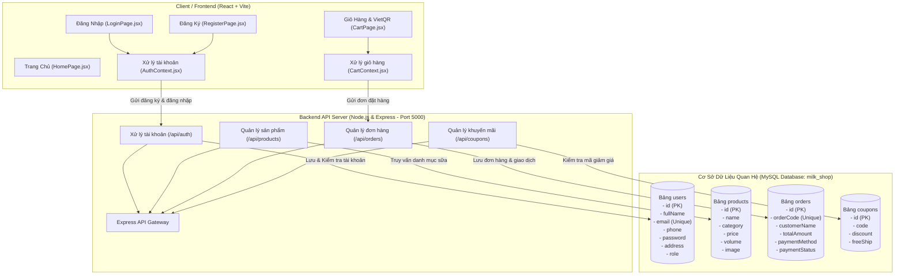

# FreshMilk Mart - Website Thương Mại Điện Tử Bán Sữa

Hệ thống website bán sữa tươi sạch chuẩn Organic được xây dựng theo mô hình kiến trúc Client - Server với **Frontend React**, **Backend Node.js & Express**, và **Cơ Sở Dữ Liệu MySQL** (chạy trên XAMPP).

---

## 🏗️ Sơ Đồ Kiến Trúc Hệ Thống & Cơ Sở Dữ Liệu MySQL (Architecture Diagram)



---

## 🗄️ Cấu Trúc Các Bảng Trong Cơ Sở Dữ Liệu MySQL (`milk_shop`)

Tệp script SQL đầy đủ được lưu tại: `database/milk_shop.sql`.

### 1. Bảng `users` (Tài khoản người dùng)
* `id`: Khóa chính tự tăng (INT, PRIMARY KEY, AUTO_INCREMENT)
* `fullName`: Họ và tên người dùng (VARCHAR(255))
* `email`: Email đăng nhập (VARCHAR(255), UNIQUE)
* `phone`: Số điện thoại (VARCHAR(50))
* `password`: Mật khẩu tài khoản (VARCHAR(255))
* `address`: Địa chỉ nhận hàng (TEXT)
* `role`: Phân quyền (VARCHAR(50), default 'customer')
* `createdAt`: Thời gian đăng ký (TIMESTAMP)

### 2. Bảng `products` (Danh mục sữa)
* `id`: Khóa chính (INT, PRIMARY KEY, AUTO_INCREMENT)
* `name`: Tên loại sữa (VARCHAR(255))
* `category`: Loại sữa ('fresh', 'nut', 'yogurt', 'baby')
* `price`: Giá bán (INT)
* `originalPrice`: Giá gốc (INT)
* `volume`: Dung tích đóng chai ('900ml', '1000ml'...)
* `image`: Đường dẫn hình ảnh (TEXT)

### 3. Bảng `orders` (Quản lý đơn hàng)
* `id`: Khóa chính (INT, PRIMARY KEY, AUTO_INCREMENT)
* `orderCode`: Mã đơn hàng duy nhất (VARCHAR(50), UNIQUE)
* `customerName`: Tên người nhận (VARCHAR(255))
* `phone`: Số điện thoại nhận hàng (VARCHAR(50))
* `address`: Địa chỉ giao hàng (TEXT)
* `totalAmount`: Tổng tiền thanh toán (INT)
* `paymentMethod`: Phương thức ('cod' hoặc 'qr')
* `paymentStatus`: Trạng thái ('pending' hoặc 'paid')
* `transactionId`: Mã giao dịch VietQR ngân hàng (VARCHAR(100))

---

## 🚀 Hướng Dẫn Khởi Chạy

```powershell
# 1. Bật Backend kết nối MySQL (Cổng 5000)
npm run server

# 2. Bật Frontend React (Cổng 5173)
npm run dev
```
